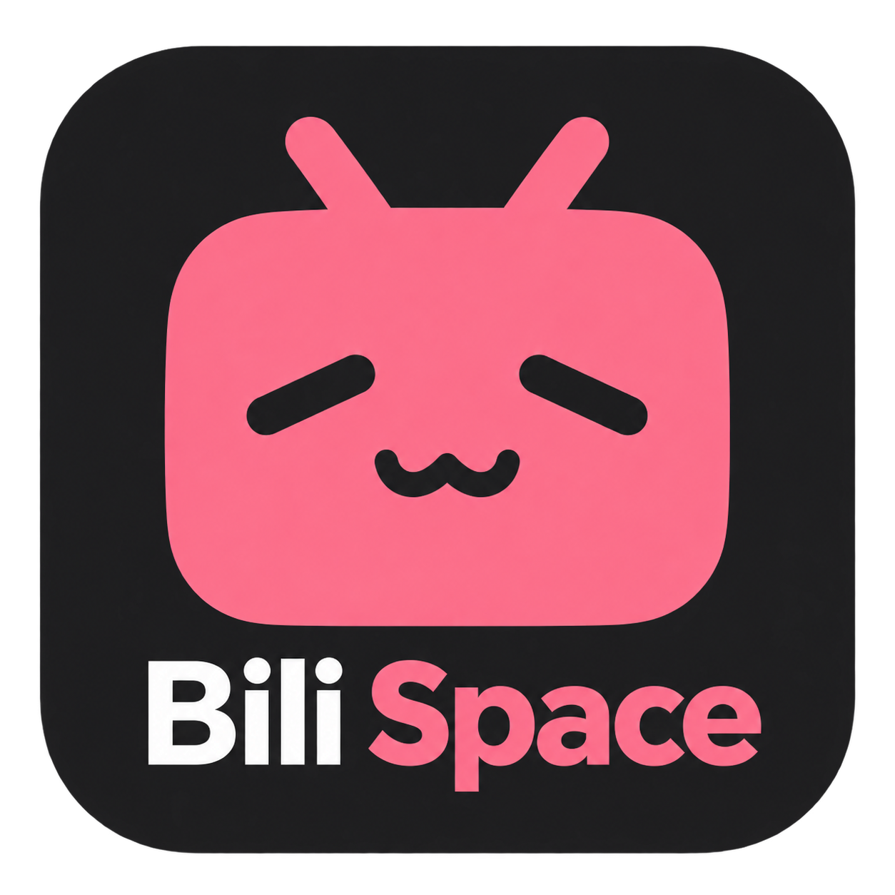
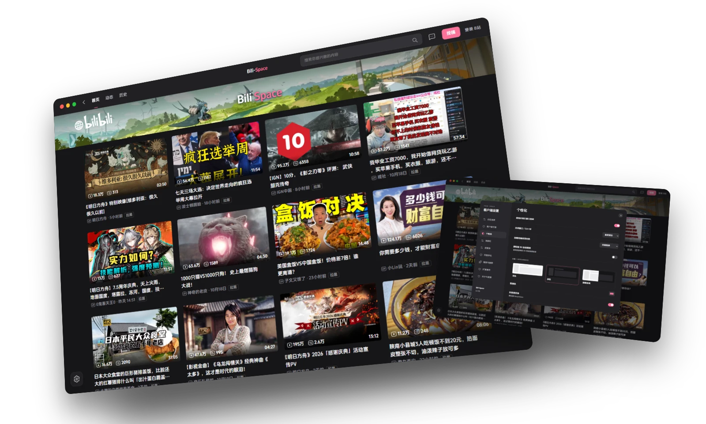
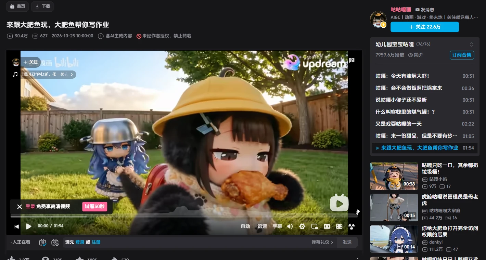
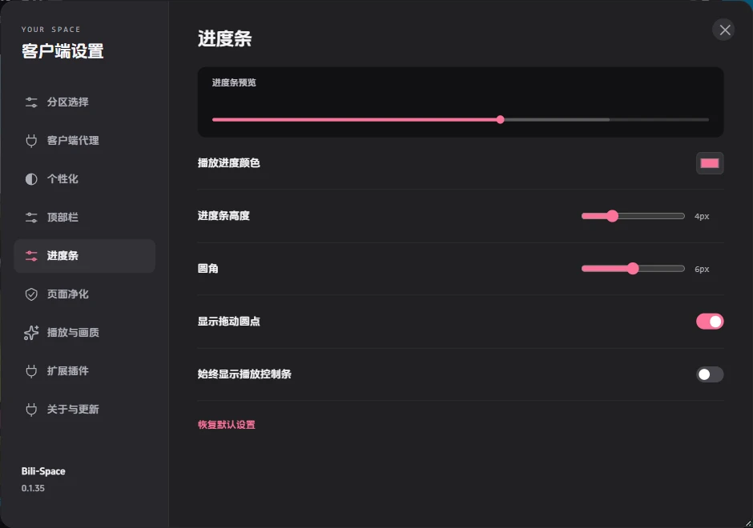
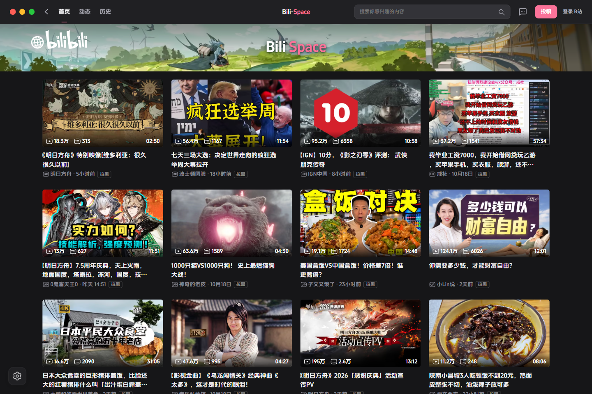
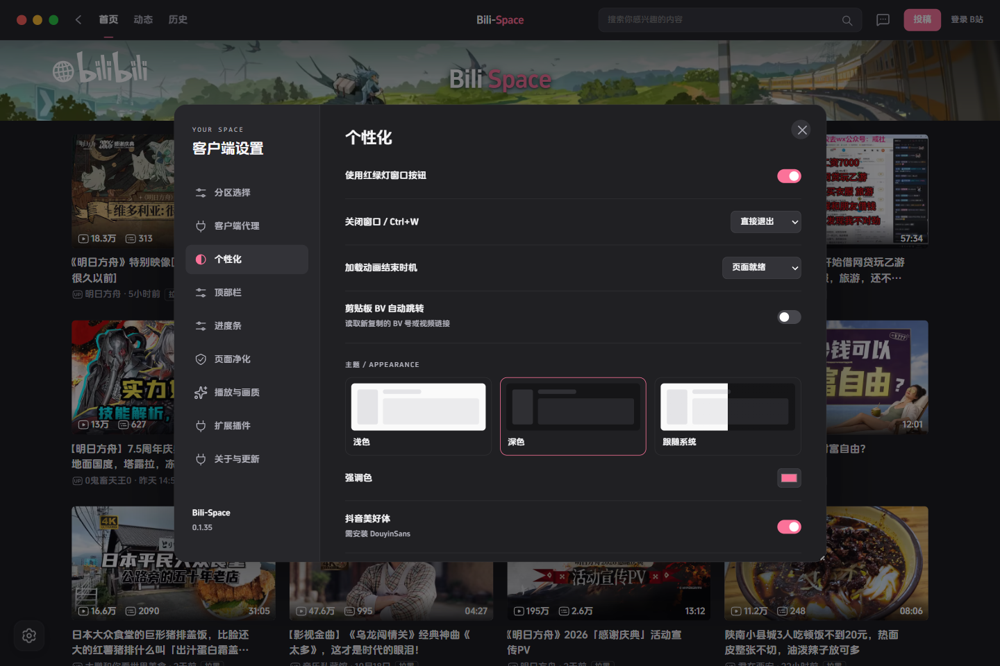

<p align="center">
  
</p>
<h1 align="center">Bili-Space</h1>
<p align="center"><strong>你的最后一款B站客户端</strong></p>
<p align="center">熟悉的 B 站，属于你的空间。</p>
<p align="center">
  <a href="../../releases">下载客户端</a> ·
  <a href="https://bili.gvqi.top">官方网站</a> ·
  <a href="#界面一览">界面一览</a> ·
  <a href="docs/CHANGELOG.md">更新日志</a>
</p>



<p align="center"><sub>Windows 10 / 11 · C++20 · WebView2 · 仅限非商业使用</sub></p>

## 为观看留出空间

**[下载安装版或便携版](https://github.com/GuqiGG/Bili-Space/releases/latest)** · 安装版提供开始菜单与卸载入口，登录和设置会保留。Windows 10/11 x64，需要 WebView2 Runtime。

保留 B站的播放器、弹幕与登录，让桌面体验更清爽。

- **看得舒服** — 深浅主题、内置抖音美好体、广告位清理、200% 音量与无边框画中画。
- **按你习惯** — 顶部栏、分区、进度条、窗口按钮，自己决定。
- **顺手就用** — 官方搜索历史与联想、首页拉黑、视频下载、剪贴板 BV 跳转。
- **随时回来** — 托盘驻留；收起暂停，双击唤起。

## 不止一个网页窗口

### 内置下载 · 把喜欢的视频留在本地

MP4 视频下载，进度、速度、预计剩余时间集中显示，下载中可随时取消。



### 无边框画中画 · 小窗，只留画面

窗口置顶，拖动到顺手的位置。没有多余的标题栏。

<p align="center"></p>

### 进度条，也有你的审美

颜色、粗细、圆角、拖动圆点，按你的习惯来。



### 还有这些，顺手的小事

| 功能 | 体验 |
| --- | --- |
| **200% 音量** | 播放器滑条与上下方向键统一调节，支持音量提示 |
| **首页拉黑** | 卡片内直接操作，同步至 B站黑名单 |
| **官方搜索** | 搜索历史、删除与联想，沿用 B站数据 |
| **剪贴板跳转** | 复制 BV 号或视频链接，跳转到对应视频 |
| **简介链接** | 识别裸域名与链接，用默认浏览器打开 |
| **自定义顶部栏** | 导航、搜索、头像与窗口按钮，自选布局 |

## 界面一览



<details>
<summary>个性化设置</summary>



</details>

<sub>实际客户端截图 · 未登录展示 · 内容由 B站提供</sub>

## 开始使用

1. 在 [Releases](../../releases) 下载 Windows x64 安装包。
2. 安装版运行 **Setup.exe**；便携版完整解压后运行 **`Bili-Space.exe`**。
3. 打开设置，选择主题和布局。

需要 [Microsoft Edge WebView2 Runtime](https://developer.microsoft.com/microsoft-edge/webview2/)。关闭窗口可选择驻留托盘或退出；按 `Ctrl+,` 打开设置，`Ctrl+W` 关闭窗口。

## 几点说明

- 超分与 AI 补帧仍是**实验功能**，默认关闭；可能卡顿、闪烁或产生伪影。
- 内置下载器支持 AVC / AAC 单视频，暂不支持批量、多段与番剧。
- 可选代理默认关闭。节点出口需符合内容授权地区，不保证免费节点的隐私与可用性。
- 独立第三方客户端，与哔哩哔哩无隶属关系，不绕过会员、付费或地区授权。

## 本地开发

```powershell
python scripts/bootstrap.py
npm ci
powershell -NoProfile -ExecutionPolicy Bypass -File scripts/build.ps1
npm test
python scripts/package.py
```

运行时、模型与插件按 `vendor` 中的来源和锁定文件准备。

[实现与历史记录](docs/IMPLEMENTATION-NOTES.md) · [通用超分调研](docs/GENERAL-SR-MODELS.md)

## 许可

自有代码与资产采用 **[PolyForm Noncommercial 1.0.0](LICENSE)**，不授权商业使用。第三方组件遵循各自许可，见 [第三方声明](THIRD_PARTY_NOTICES.md)。作者未署名。
