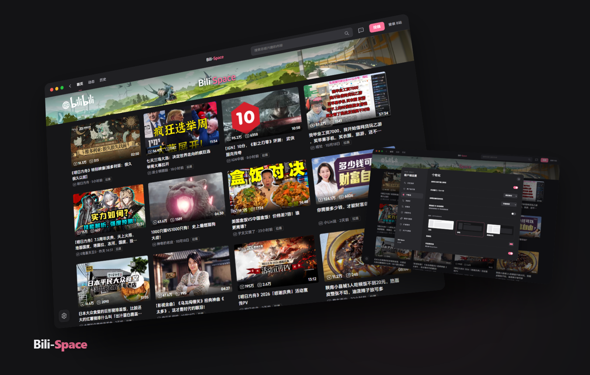

<p align="center">
  
</p>
<h1 align="center">Bili-Space</h1>
<p align="center"><strong>你的最后一款B站客户端</strong></p>
<p align="center">熟悉的 B 站，属于你的空间。</p>
<p align="center">
  <a href="../../releases">下载客户端</a> ·
  <a href="#界面一览">界面一览</a> ·
  <a href="docs/CHANGELOG.md">更新日志</a>
</p>



<p align="center"><sub>Windows 10 / 11 · C++20 · WebView2 · 仅限非商业使用</sub></p>

## 为观看留出空间

保留 B站的播放器、弹幕与登录，让桌面体验更清爽。

- **看得舒服** — 深浅主题、广告位清理、200% 音量与无边框画中画。
- **按你习惯** — 顶部栏、分区、进度条、窗口按钮，自己决定。
- **顺手就用** — 官方搜索历史与联想、首页拉黑、视频下载、剪贴板 BV 跳转。
- **随时回来** — 托盘驻留；收起暂停，唤起继续。

## 界面一览

### 首页 · 内容在前，干扰在后


### 个性化 · 把空间调成你的样子


<details>
<summary>查看视频播放界面</summary>


</details>

<sub>截图来自独立、未登录的实际客户端。展示内容由 B站提供，不随安装包附带。</sub>

## 开始使用

1. 在 [Releases](../../releases) 下载 Windows x64 安装包。
2. 完整解压，运行 **`Bili-Space.exe`**。
3. 打开设置，选择主题和布局。

需要 [Microsoft Edge WebView2 Runtime](https://developer.microsoft.com/microsoft-edge/webview2/)。关闭窗口可选择驻留托盘或退出；按 `Ctrl+,` 打开设置，`Ctrl+W` 关闭窗口。

## 几点说明

- 超分与 AI 补帧仍是**实验功能**，默认关闭；可能卡顿、闪烁或产生伪影。
- 内置下载器支持 AVC / AAC 单视频，暂不支持批量、多段与番剧。
- 可选代理默认关闭。节点出口需符合内容授权地区，不保证免费节点的隐私与可用性。
- 独立第三方客户端，与哔哩哔哩无隶属关系，不绕过会员、付费或地区授权。

## 开发与部署

```powershell
python scripts/bootstrap.py
npm ci
powershell -NoProfile -ExecutionPolicy Bypass -File scripts/build.ps1
npm test
python scripts/package.py
```

运行时、模型与插件按 `vendor` 中的来源和锁定文件准备。

[更新网站部署](UPDATE-SITE.md) · [实现与历史记录](docs/IMPLEMENTATION-NOTES.md) · [通用超分调研](docs/GENERAL-SR-MODELS.md)

## 许可

自有代码与资产采用 **[PolyForm Noncommercial 1.0.0](LICENSE)**，不授权商业使用。第三方组件遵循各自许可，见 [第三方声明](THIRD_PARTY_NOTICES.md)。作者未署名。
