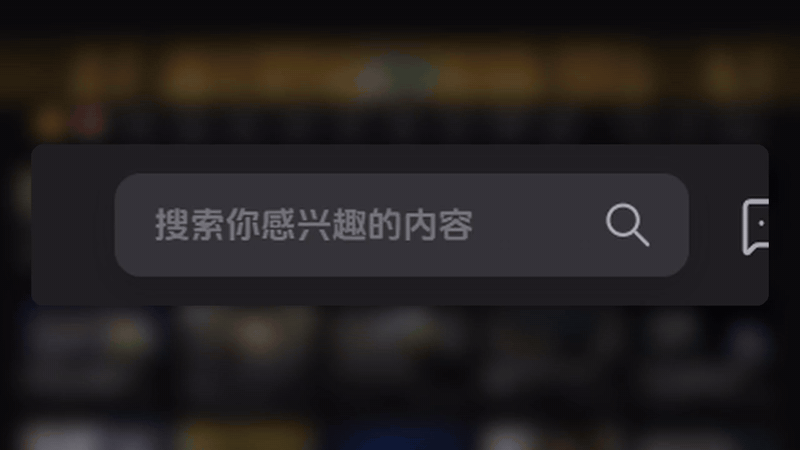
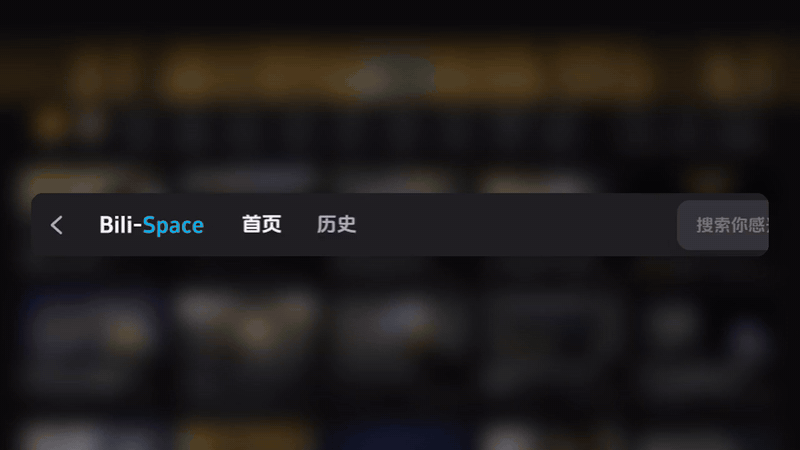
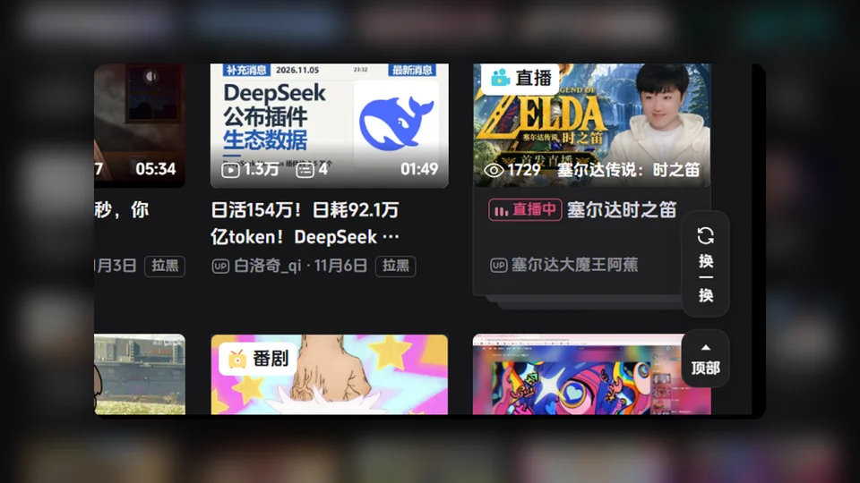
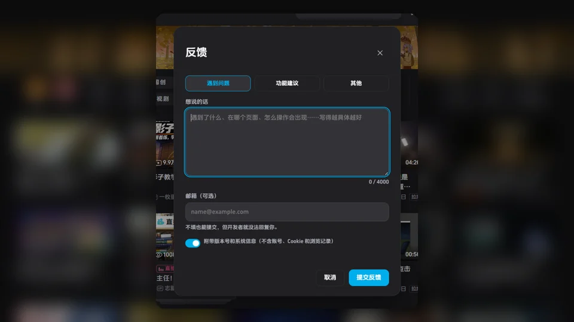

# Bili-Space 0.1.63

这一版主要打磨顶栏和首页：更多细腻的动画、更顺手的按钮，还有一个可以直接找到开发者的反馈入口。更新后第一次打开，会有一个更新公告带你看一遍。

## 顶栏

- 搜索框会说话了：鼠标停在空的搜索框上，提示文字会被一句随机小词条替换，从左往右带着动态模糊扫进来，移开时再缩回去。今日宜忌、小动物的日常、搜索框的心里话、客户端小技巧……一共两千多条，抽完一轮才会重复，同一类不会连着出现。
- 分区展开和收起换成 Q 弹的弹簧动画：展开时分区一个接一个从按钮里弹出来，落地时像果冻一样晃两下；收起时先蓄力，再被吸回按钮，离按钮最近的先走。整套动画比之前快了 14%。
- 「首页 / 动态 / 历史」会等分区收回去之后才出现，不再和分区字叠在一起。
- 窗口右上角的三个按钮在鼠标移开时各有一段小动画：× 转三圈带残影停下，□ 像软方块一样晃一下，— 会被鼠标往离开的方向拽弯再弹回去。
- 鼠标停在消息图标上时，里面的三个点会依次变大、变回去，一直循环。
- Ctrl+滚轮缩放时，顶栏和网页一起变大变小；在顶栏上按 Ctrl+滚轮也能缩放。
- 顶栏时钟换成抖音美好体。
- 搜索历史：悬停时历史词和右边的 × 作为一个整体一起弹，× 和文字对齐，悬停底色填满整个胶囊。
- 搜索图标在搜索框里垂直居中；消息菜单里红点数字的位置更正。
- 「后退 / 前进」按钮悬停时的底色不再被切掉一块。

## 首页

- 「换一换」和「顶部」搬进了客户端：首页右下角是客户端自己的一列按钮，样式和左下角的设置按钮统一，不会再和网页的按钮挤在一起。往下滚动后才出现「顶部」；在页面中间点「换一换」会先回到顶部再换一批。
- 去掉了首页右下角的「稍后再看」、「新版反馈」和「客服」悬浮按钮。

## 反馈

- 新增反馈：设置里的「反馈」页，或者托盘图标右键「反馈问题…」，都能直接把问题或建议发给开发者。可以选「遇到问题 / 功能建议 / 其他」；邮箱可以不填，但填了开发者才能回复你；可以选择附带版本号和系统信息，不包含账号、Cookie 和浏览记录。
- 反馈不限次数，每次间隔半分钟；没发出去的内容会自动保留，下次打开还在。

## 更新公告

- 新增更新公告：每个版本更新后第一次打开时，会弹出图文和动图介绍这次更新了什么，可以用按钮、圆点或键盘左右键翻页，按 ×、Esc 或「知道了」关闭，只出现一次。之后可以在 设置 → 关于与更新 里重新打开。新安装的用户会在欢迎引导之后看到。

## 个性化

- 视频页顶栏的「复制视频链接」可以关掉，也可以改成只显示一个小小的圆角链接图标（个性化 → 顶部栏与首页）。
- 第一次启动的默认窗口改为 1192×812，屏幕较小时按同一比例整体缩小。

## 修复

- 登录框、线程撕裂者设置这类弹窗可以正常点击了，不会再点到弹窗后面的首页视频。
- 窗口最大化时，视频页的发弹幕栏不再压住点赞、投币那一行。
- 视频网页全屏时，左下角的设置和投稿按钮会自动让开，不再挡住播放器控制栏。
- 往下滚动后播放器变成小窗时，页面不会跳动。

另外，客户端里还藏了几个小彩蛋，等你自己发现。
